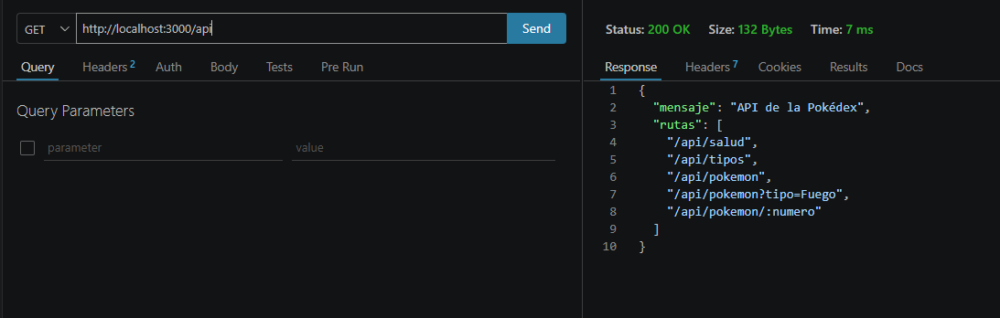
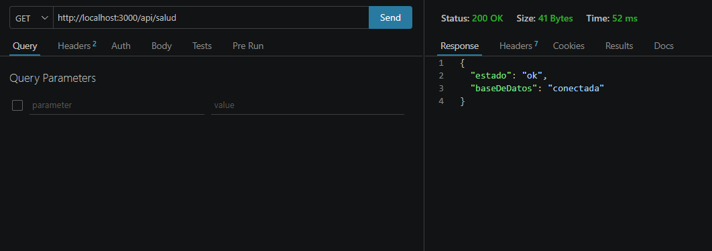
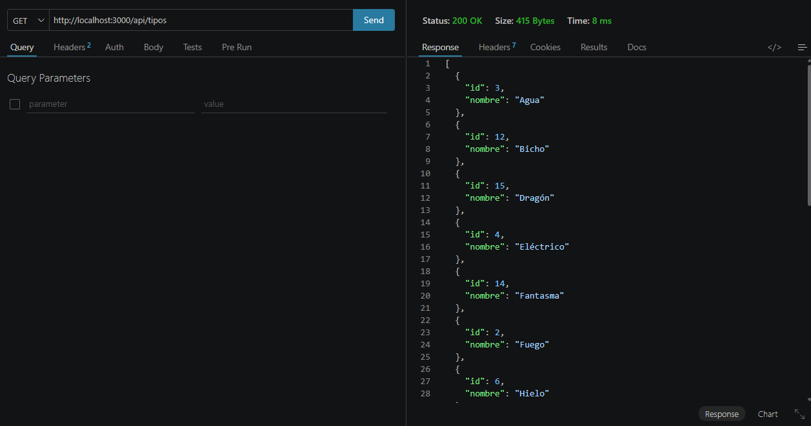
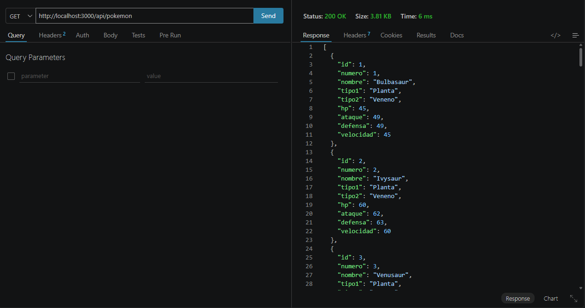
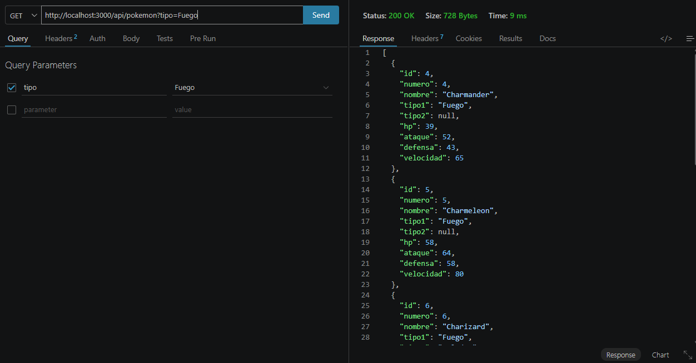
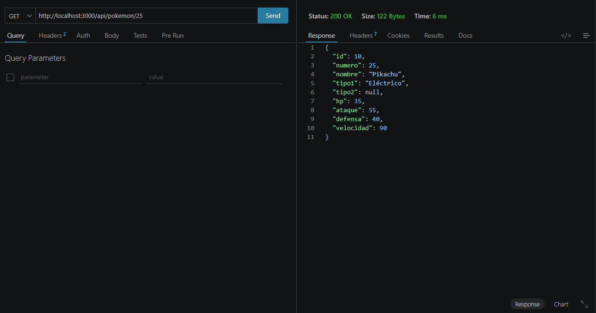
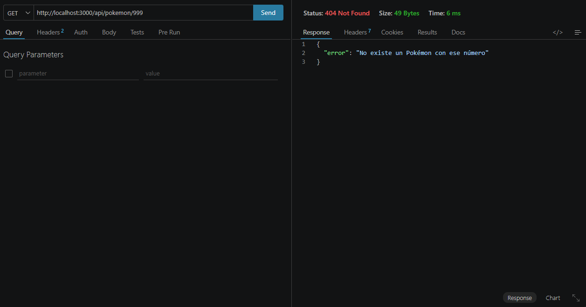
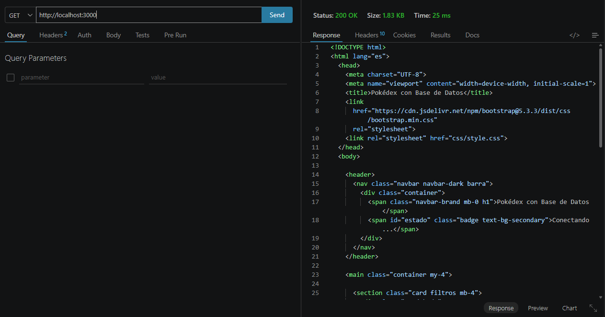

# Pruebas de rutas con Thunder Client

Las rutas de la API se probaron con **Thunder Client** (extensión de VS Code),
con el servidor encendido (`npm start` dentro de `backend/`) y la base de datos MySQL cargada.

## Cómo se hicieron las pruebas
1. Se abrió Thunder Client (ícono del rayo) y se pulsó **New Request**.
2. Se eligió el método **GET**, se pegó la URL y se pulsó **Send**.
3. Se revisó el **Status** y la respuesta en JSON.
4. Se guardó una captura de cada prueba en la carpeta `capturas/`.

## Resumen de resultados

| N.º | Descripción | Método | URL | Esperado | Obtenido | ¿Coincide? |
|---|---|---|---|---|---|---|
| 1 | Información de la API | GET | http://localhost:3000/api | 200 OK | 200 OK | Sí |
| 2 | Conexión a la base de datos | GET | http://localhost:3000/api/salud | 200 OK | 200 OK | Sí |
| 3 | Lista de tipos | GET | http://localhost:3000/api/tipos | 200 OK | 200 OK | Sí |
| 4 | Todos los Pokémon | GET | http://localhost:3000/api/pokemon | 200 OK | 200 OK | Sí |
| 5 | Filtrar por tipo | GET | http://localhost:3000/api/pokemon?tipo=Fuego | 200 OK | 200 OK | Sí |
| 6 | Un Pokémon por número | GET | http://localhost:3000/api/pokemon/25 | 200 OK | 200 OK | Sí |
| 7 | Pokémon que no existe | GET | http://localhost:3000/api/pokemon/999 | 404 Not Found | 404 Not Found | Sí |
| 8 | Página principal (extra) | GET | http://localhost:3000 | 200 OK | 200 OK | Sí |

## Evidencia

### 1. Información de la API
`GET /api` devuelve un mensaje y la lista de rutas disponibles.

### 2. Conexión a la base de datos
`GET /api/salud` ejecuta una consulta a MySQL y responde `"estado": "ok"` y `"baseDeDatos": "conectada"`.

### 3. Lista de tipos
`GET /api/tipos` devuelve los tipos guardados en la tabla `tipos`, ordenados por nombre.

### 4. Todos los Pokémon
`GET /api/pokemon` devuelve los Pokémon de la tabla `pokemon` junto con el nombre de sus tipos.

### 5. Filtrar por tipo
`GET /api/pokemon?tipo=Fuego` usa el parámetro `tipo` y devuelve solo los Pokémon de tipo Fuego (Charmander, Charmeleon, Charizard, etc.).

### 6. Un Pokémon por número
`GET /api/pokemon/25` devuelve un solo Pokémon: Pikachu, tipo Eléctrico.

### 7. Pokémon que no existe (manejo de errores)
`GET /api/pokemon/999` responde **404 Not Found** con un mensaje de error. Es el resultado correcto: comprueba que la API maneja bien un número que no existe.

### 8. Página principal (extra)
`GET /` devuelve el HTML de la página, porque el mismo servidor entrega la carpeta `frontend`.

## Conclusión
Las 8 pruebas respondieron como se esperaba: las rutas de la API leen datos reales de MySQL,
el filtro por tipo funciona desde la URL y los errores se manejan con un 404 claro.
